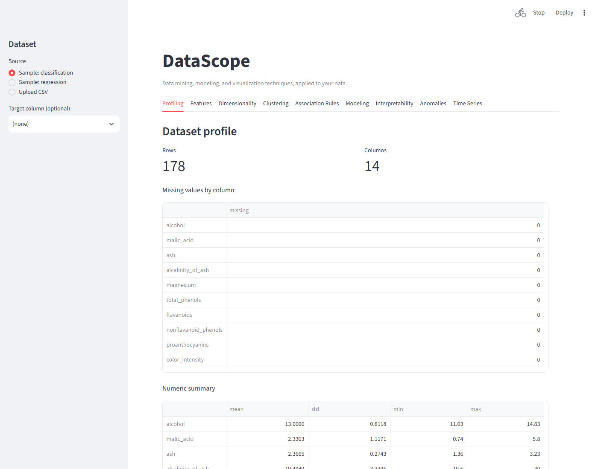

# DataScope

**An end-to-end data mining and visualization toolkit covering the core techniques a data scientist uses — with an interactive dashboard, not just notebooks.**

**Live demo:** not yet deployed — see [Deploying a live demo](#deploying-a-live-demo) below to add one.

```bash
pip install datascope
datascope app
```



Upload a CSV (or use a bundled sample dataset) and explore every stage of a
typical data science workflow through interactive Plotly charts:

| Technique | What it covers |
|---|---|
| **Profiling** | Missing values, dtypes, numeric summaries |
| **Feature engineering** | Mutual information ranking, polynomial features, RFE |
| **Dimensionality reduction** | PCA, t-SNE (UMAP as an optional extra) |
| **Clustering** | KMeans with elbow/silhouette diagnostics, DBSCAN, hierarchical |
| **Association rule mining** | Apriori/FP-Growth market-basket analysis (optional extra) |
| **Modeling** | Classification & regression baselines with cross-validation |
| **Interpretability** | Permutation feature importance (SHAP as an optional extra) |
| **Anomaly detection** | Isolation Forest, Local Outlier Factor |
| **Time series** | Seasonal decomposition, ACF/PACF |

## Why

Most "data science portfolio" repos are a pile of notebooks that only make
sense to the person who wrote them. DataScope is the opposite: every
technique is a small, independently testable, importable function — and
they're all wired into one Streamlit dashboard so you (or anyone reviewing
your work) can run them against real data and see the result immediately,
without reading code.

## Install

```bash
pip install datascope                  # core: profiling, features, PCA/t-SNE,
                                        # clustering, modeling, interpretability,
                                        # anomaly detection, time series
pip install datascope[association]     # + Apriori/FP-Growth rule mining
pip install datascope[advanced]        # + UMAP
pip install datascope[interpret]       # + SHAP
```

## Usage

### Dashboard

```bash
datascope app
```

### Python API

Every technique is also directly importable — no dashboard required:

```python
import pandas as pd
from datascope import clustering, dimensionality, modeling, profiling

df = pd.read_csv("data.csv")

report = profiling.profile(df)
print(report.missing_by_column)

embedding = dimensionality.pca(df[numeric_cols], n_components=2)

clusters = clustering.kmeans(df[numeric_cols], n_clusters=4)
print(clusters.silhouette)

results = modeling.run_classifiers(df[feature_cols], df["target"])
best_model = results[0].fitted_model
```

## Deploying a live demo

This repo is ready to deploy on [Streamlit Community Cloud](https://share.streamlit.io) (free):

1. Sign in at share.streamlit.io with your GitHub account.
2. Click "New app", pick this repo and branch, and set the main file path to `src/datascope/app.py`.
3. Deploy. It reads `requirements.txt` (which installs this package in editable mode) automatically.
4. Copy the resulting `*.streamlit.app` URL into the "Live demo" line at the top of this README.

## Design

Same philosophy as [CorpusLens](https://github.com/amir-khjp/corpuslens):
one file per technique (`src/datascope/clustering.py`,
`src/datascope/anomaly.py`, ...), plain functions over pandas
DataFrames/Series, a matching test file per module, and heavy/niche
dependencies (UMAP, SHAP, mlxtend) kept as optional extras so the core
install stays light and fast.

## Status

Early and actively developed. Issues and PRs welcome — see
[CONTRIBUTING.md](CONTRIBUTING.md) for good first issues (UMAP/SHAP
dashboard tabs, ARIMA forecasting, hyperparameter tuning, and more).

## License

MIT
